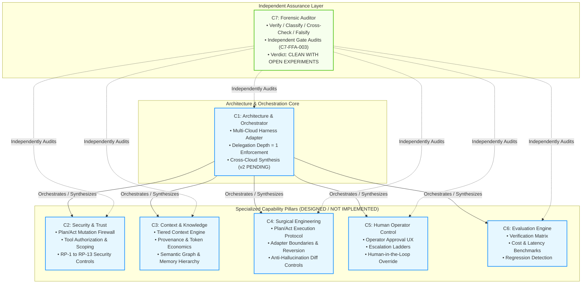
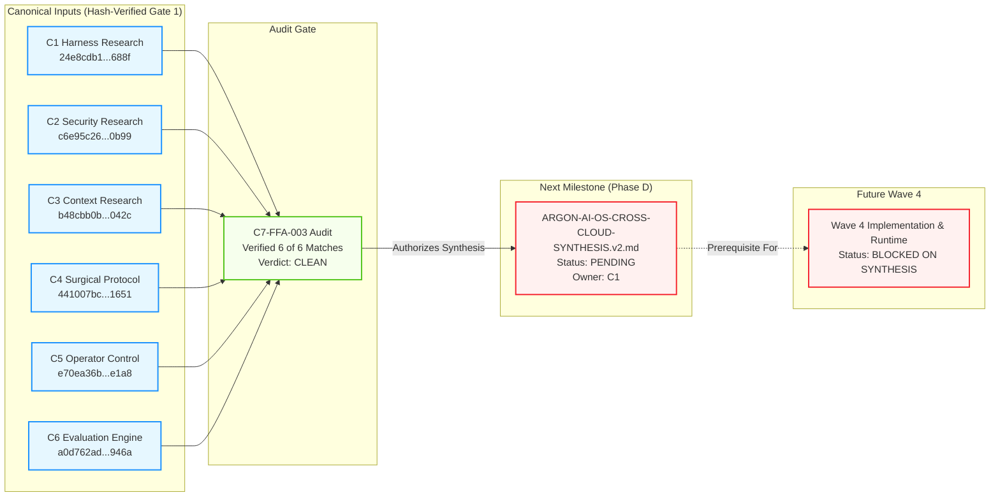

# SYSTEM MAP — ARGON AI-OS Architecture & Cloud Collaboration

This document describes the seven Cloud roles, their verified dependencies, and boundaries grounded strictly in verified research artifacts.

---

## 1. Seven-Cloud Responsibility & Authority Model

---

## 2. Artifact Provenance & Synthesis Flow

---

## 3. Plan/Act 5-Vector Mutation Defense Convergence & Divergence

A critical architectural pattern across C1, C2, and C4 is the **5-Vector Mutation Test** for enforcing read-only plan phases:

| Vector # | Attack Vector Description | C1 Agreement | C2 Agreement | C4 Definition | Convergence Status |
| :--- | :--- | :--- | :--- | :--- | :--- |
| **Vector 1** | Direct file write tool call | Yes (E2) | Yes (RP-1) | Yes (Pattern F) | **CONFIRMED CONVERGENT** |
| **Vector 2** | Shell command writing to file | Yes (E2) | Yes (RP-1) | Yes (Pattern F) | **CONFIRMED CONVERGENT** |
| **Vector 3** | Interpreter write (python/node) | Yes (E2) | Yes (RP-1) | Yes (Pattern F) | **CONFIRMED CONVERGENT** |
| **Vector 4** | Wrapper / composite command | Yes (E2) | Yes (RP-1) | Yes (Pattern F) | **CONFIRMED CONVERGENT** |
| **Vector 5** | Indirect mutation | **Nested tool call** | **Nested tool call** | **Argument injection into read-only tool** | **MINOR TAXONOMY DIVERGENCE** (Non-blocking) |

*Resolution Note from C7-FFA-003:* Both interpretations represent genuine attack surfaces. C1 will reconcile the wording during Synthesis v2.

---

## 4. Delegation Depth Boundary

All clouds have converged on **Delegation Depth = 1**:
- C1 (Orchestrator) can spawn C2–C6 subagents.
- Subagents (C2–C6) cannot recursively spawn nested agents (`Depth <= 1`).
- Sourced from empirical vendor issue tracking (e.g., recursive spawning defects in nested multi-agent systems).
